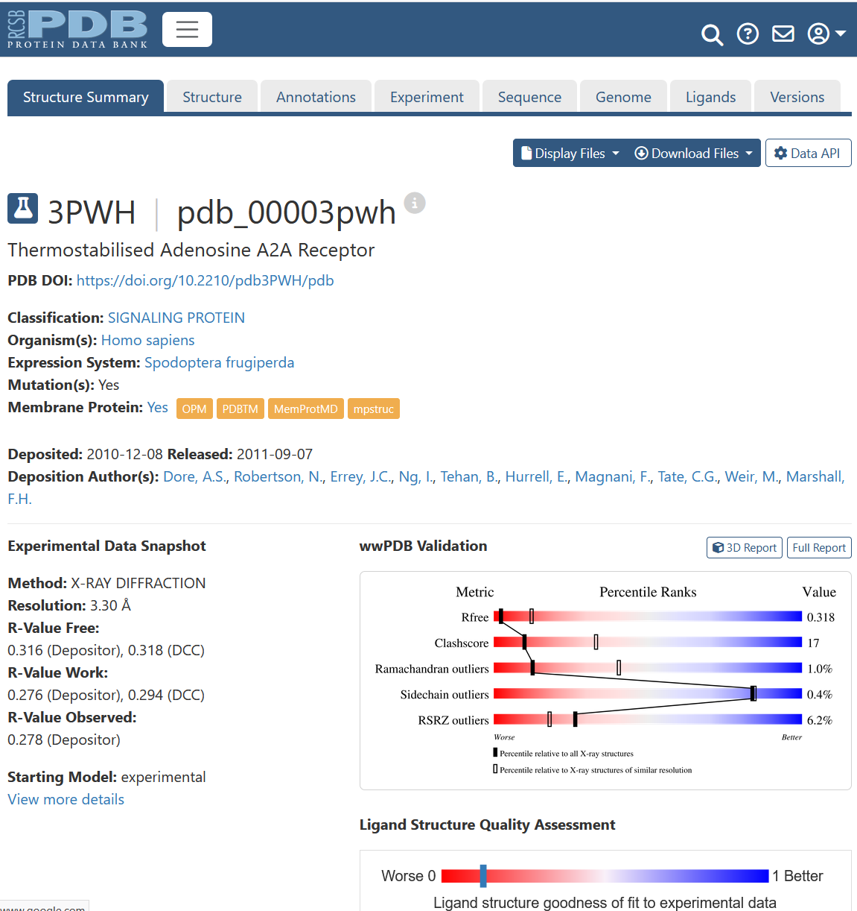
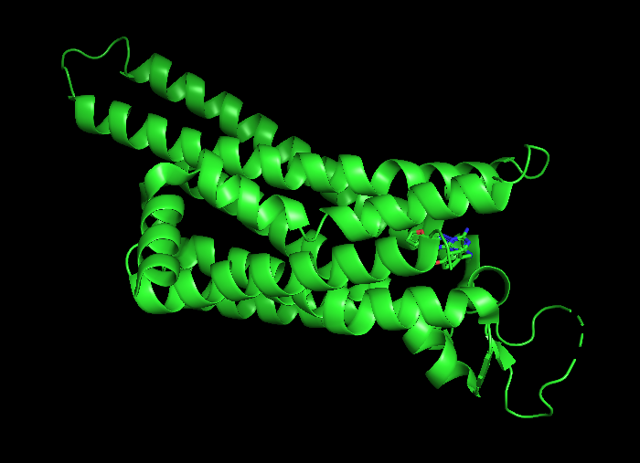
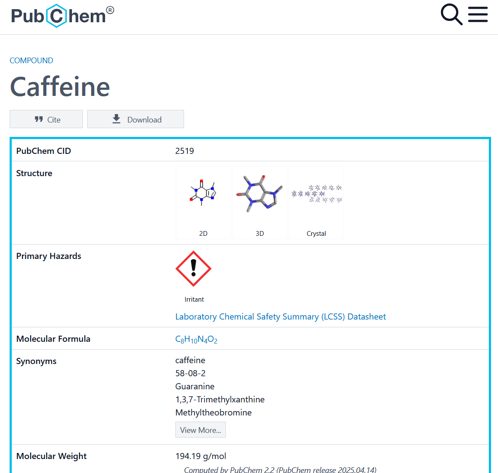
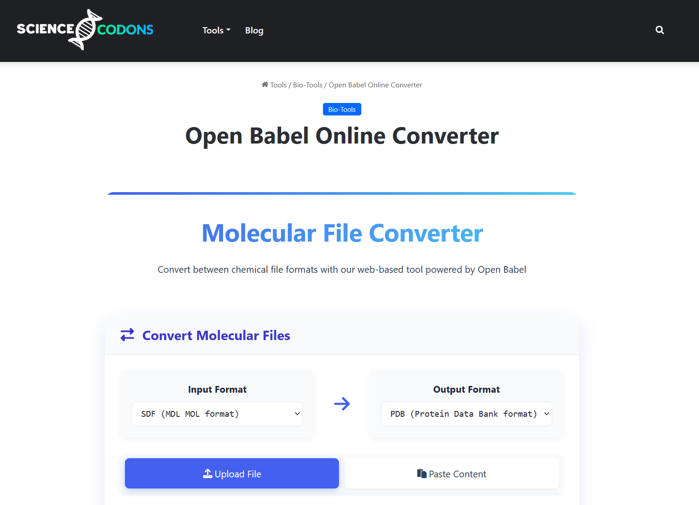
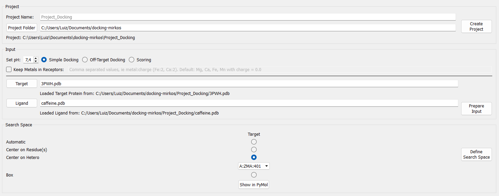
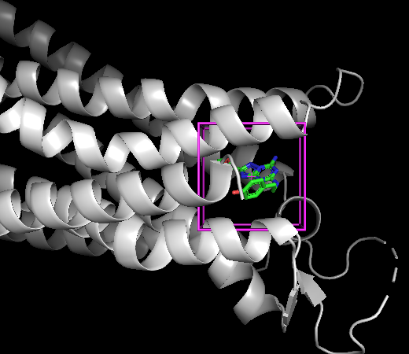
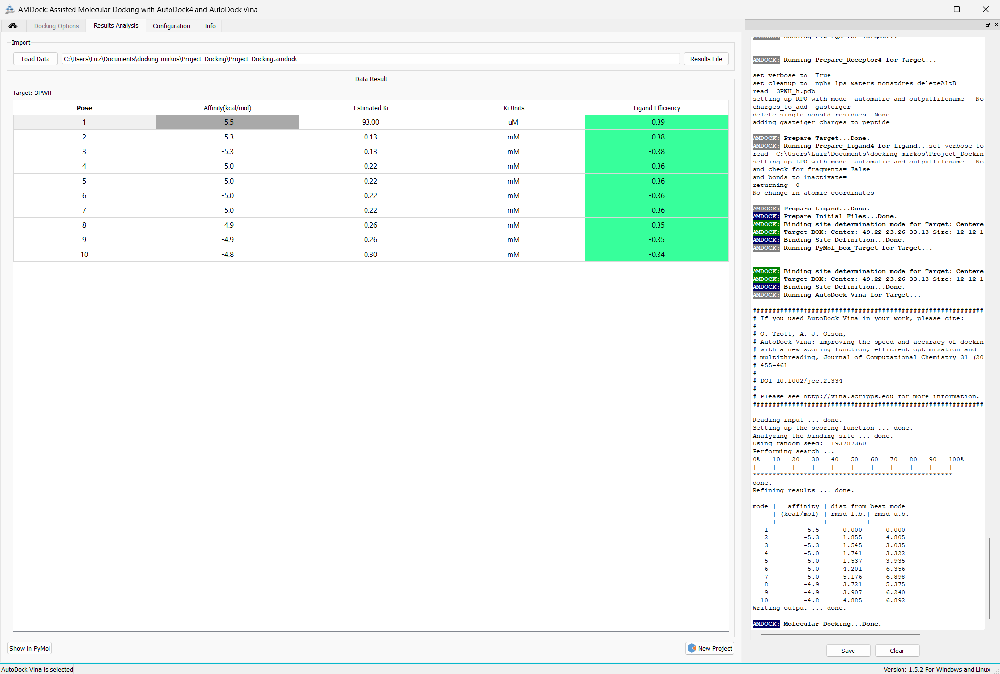
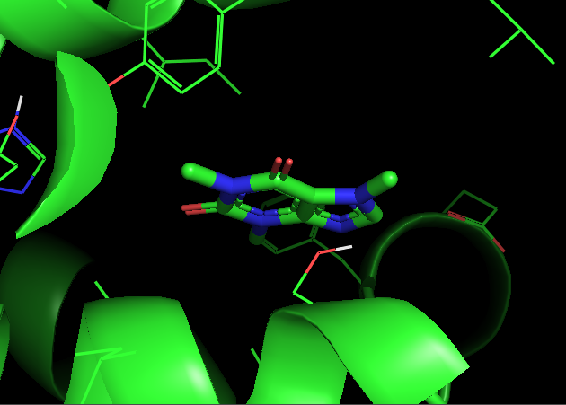

# Estudo introdutório de docking molecular da cafeína no recetor de adenosina A2A

**Luiz Batista Cardoso**  
**Disciplina:** Modelagem Atômica Molecular  
**Programa:** Pós Graduação em Nanociências  
**Data:** 30 de setembro de 2026

---

## Resumo

Este trabalho apresenta uma análise introdutória da interação entre a cafeína e o recetor humano de adenosina A2A, cuja estrutura de referência é o complexo cristalográfico com o código PDB `3PWH`. O objetivo foi obter uma hipótese estrutural para a acomodação da cafeína no sítio ortostérico do recetor e avaliar a sua pontuação de docking com o AutoDock Vina, através da interface AMDock.

A melhor solução calculada apresentou uma afinidade prevista de `-5,5 kcal/mol` e uma constante de inibição aparente estimada de `93,00 µM`. Estes valores são compatíveis com uma interação de magnitude micromolar prevista pelo modelo utilizado. Contudo, devem ser interpretados como resultados computacionais aproximados. O docking não mede diretamente a afinidade experimental, não demonstra por si só a ocorrência de inibição competitiva e não permite concluir, sem ensaios adicionais, que a cafeína reproduz integralmente o mecanismo farmacológico observado em sistemas biológicos.

## 1. Introdução

O recetor de adenosina A2A é um recetor acoplado a proteína G que participa na sinalização da adenosina no sistema nervoso central. A cafeína é habitualmente descrita como um antagonista dos recetores de adenosina, incluindo o subtipo A2A. Ao ocupar o sítio de ligação da adenosina ou de ligandos antagonistas, pode reduzir a ativação do recetor por competição pelo mesmo espaço molecular.

O docking molecular é uma abordagem computacional utilizada para propor orientações possíveis de um ligando numa cavidade de uma proteína e para atribuir uma pontuação aproximada a cada orientação. O resultado é útil para gerar hipóteses sobre o reconhecimento molecular, mas não substitui medições experimentais de afinidade, ensaios funcionais ou estudos de dinâmica molecular. Por essa razão, neste relatório os resultados são apresentados como previsões de docking e não como uma demonstração experimental do mecanismo de ação da cafeína.

## 2. Objetivo

O objetivo foi avaliar se a cafeína pode ser acomodada, segundo o modelo de docking utilizado, na região ortostérica do recetor A2A definida pela posição do ligando co-cristalizado `A:ZMA:401` na estrutura `3PWH`.

Foram considerados os seguintes objetivos específicos:

1. Preparar a estrutura do recetor e a estrutura da cafeína para o cálculo.
2. Definir uma caixa de procura centrada no sítio ocupado pelo ligando co-cristalizado.
3. Gerar várias poses de docking com o AutoDock Vina.
4. Comparar as pontuações das poses e descrever a melhor solução de forma prudente.

## 3. Metodologia

### 3.1 Estrutura do recetor

A estrutura tridimensional do recetor A2A foi obtida a partir do RCSB Protein Data Bank, utilizando o código PDB `3PWH`. A estrutura foi visualizada no PyMOL para confirmar a organização geral do recetor e a presença do ligando co-cristalizado utilizado como referência espacial.

**Figura 1.** Obtenção da estrutura tridimensional do recetor de adenosina A2A humano, com o código PDB `3PWH`, no repositório RCSB Protein Data Bank.

**Figura 2.** Visualização em representação de fita da estrutura do recetor A2A no PyMOL. Esta representação permite reconhecer a arquitetura global do recetor e localizar a região geral onde se encontra o ligando co-cristalizado.

### 3.2 Ligando

A cafeína foi identificada na base de dados PubChem e a sua estrutura foi preparada para utilização no docking. A molécula é pequena, rígida e contém grupos carbonilo e átomos de azoto que podem contribuir para o reconhecimento molecular através de interações polares. A interpretação dessas interações deve, no entanto, considerar a protonação, as cargas parciais, a orientação dos grupos funcionais e a geometria efetivamente prevista pelo programa.

**Figura 3.** Registo da molécula de cafeína na base de dados PubChem, utilizado como fonte para a estrutura do ligando.

**Figura 4.** Conversão do ficheiro estrutural da cafeína para um formato compatível com a preparação e execução do docking molecular através da plataforma Open Babel.

### 3.3 Preparação e espaço de procura

O recetor e a cafeína foram importados para o AMDock. Nesta etapa foram utilizados os ficheiros preparados do recetor e do ligando, incluindo os parâmetros necessários ao cálculo de docking.

O projeto foi configurado no modo simples com o AutoDock Vina como programa de docking. A caixa de procura foi centrada no heteroátomo de referência `A:ZMA:401`, correspondente ao ligando co-cristalizado na estrutura `3PWH`. De acordo com o ficheiro de projeto, o centro da caixa foi definido nas coordenadas `49,22`, `23,26` e `33,13`, com dimensões de `12 x 12 x 12 Å`.

**Figura 5.** Configuração do espaço de procura no AMDock. A caixa foi centrada na posição do ligando co-cristalizado `A:ZMA:401`, de modo a explorar a cavidade ortostérica do recetor.

**Figura 6.** Representação tridimensional da caixa de procura no PyMOL. A caixa, apresentada a rosa, delimita a região utilizada pelo algoritmo para procurar orientações favoráveis da cafeína.

## 4. Resultados

### 4.1 Pontuações obtidas

O cálculo gerou dez poses para a cafeína. A Pose 1 foi a solução com a melhor pontuação, com uma afinidade prevista de `-5,5 kcal/mol`. O AMDock associou a esta pose uma constante de inibição estimada de `93,00 µM`.

As poses 2 e 3 apresentaram `-5,3 kcal/mol`, com valores estimados de `0,13 mM`, equivalentes a aproximadamente `130 µM`. As poses 4 a 7 apresentaram `-5,0 kcal/mol`, enquanto as poses 8 e 9 apresentaram `-4,9 kcal/mol` e a Pose 10 apresentou `-4,8 kcal/mol`.

| Pose | Afinidade prevista | $K_i$ estimado | RMSD em relação à melhor pose |
|---:|---:|---:|---:|
| 1 | -5,5 kcal/mol | 93,00 µM | 0,000 Å |
| 2 | -5,3 kcal/mol | 0,13 mM | 1,855 Å |
| 3 | -5,3 kcal/mol | 0,13 mM | 1,545 Å |
| 4 | -5,0 kcal/mol | 0,22 mM | 1,741 Å |
| 5 | -5,0 kcal/mol | 0,22 mM | 1,537 Å |
| 6 | -5,0 kcal/mol | 0,22 mM | 4,201 Å |
| 7 | -5,0 kcal/mol | 0,22 mM | 5,176 Å |
| 8 | -4,9 kcal/mol | 0,26 mM | 3,721 Å |
| 9 | -4,9 kcal/mol | 0,26 mM | 3,907 Å |
| 10 | -4,8 kcal/mol | 0,30 mM | 4,885 Å |

**Figura 7.** Painel de resultados do AMDock com as afinidades previstas pelo AutoDock Vina e os valores de $K_i$ estimados para as dez poses obtidas.

### 4.2 Interpretação das poses

A diferença entre a primeira e a segunda pose é de `0,2 kcal/mol`. Esta diferença é pequena quando comparada com a incerteza habitual associada às funções de pontuação de docking. Por isso, a Pose 1 pode ser reportada como a melhor solução segundo o cálculo, mas não deve ser tratada como uma estrutura única e inequívoca. As poses 2 e 3 também são relevantes porque apresentam pontuações próximas e RMSD inferior a aproximadamente `2 Å` relativamente à primeira pose.

As poses com RMSD mais elevado indicam orientações alternativas do ligando dentro ou nas proximidades da região explorada. A existência de várias soluções com pontuações próximas sugere que o modelo não selecionou uma única orientação com grande separação energética das restantes. Esta observação é importante para a discussão, pois a classificação das poses por pontuação não fornece, por si só, uma estimativa da probabilidade real de cada conformação no recetor.

**Figura 8.** Vista detalhada da pose acoplada da cafeína na cavidade do recetor A2A. A imagem mostra a localização espacial proposta pelo docking, mas não deve ser interpretada isoladamente como prova de contactos específicos, de ligação competitiva ou de atividade farmacológica.

## 5. Discussão

### 5.1 Significado da afinidade prevista

O valor de `-5,5 kcal/mol` indica que, segundo a função de pontuação do AutoDock Vina, a Pose 1 é a orientação mais favorável entre as soluções calculadas. O valor de `93,00 µM` é uma constante de inibição estimada pelo programa a partir da pontuação, e não uma constante determinada experimentalmente.

Em termos qualitativos, o resultado aponta para uma interação prevista de magnitude micromolar. Esta previsão é compatível com a ideia de que a cafeína pode ser acomodada no sítio de ligação do recetor A2A, mas a comparação direta com valores experimentais deve ser feita com cautela. Valores de docking dependem do estado conformacional da proteína, da preparação estrutural, das cargas, do tratamento dos solventes, do tamanho da caixa e da função de pontuação utilizada.

### 5.2 Relação com a inibição competitiva

A caixa de procura foi colocada no local ocupado pelo ligando co-cristalizado `A:ZMA:401`. Assim, o cálculo testou a possibilidade de a cafeína ocupar a região ortostérica do recetor. Esta escolha apoia uma hipótese estrutural de competição pelo sítio de ligação.

Ainda assim, ocupar a mesma cavidade não demonstra por si só uma relação competitiva no sentido farmacológico. Para sustentar essa conclusão seriam necessários, por exemplo, ensaios de deslocamento de ligando, curvas concentração-resposta com diferentes concentrações de adenosina, determinação experimental de $K_i$ ou estudos funcionais com o recetor. O resultado deste trabalho deve, portanto, ser descrito como uma evidência computacional preliminar consistente com a hipótese de ligação ortostérica, e não como uma prova definitiva de antagonismo competitivo.

### 5.3 Observações estruturais

A cafeína não possui ligações rotáveis ativas no ficheiro de saída, como indicado pelo valor `TORSDOF 0`. Assim, a diversidade de poses resulta principalmente de diferentes orientações e posicionamentos da molécula na cavidade, e não de uma exploração extensa de conformações internas do ligando.

A inspeção visual da pose é útil para confirmar que a molécula se encontra na região esperada e que não está claramente fora da caixa ou em conflito grosseiro com a estrutura. No entanto, uma discussão rigorosa das interações intermoleculares exigiria uma análise específica de distâncias e ângulos, incluindo pontes de hidrogénio, contactos hidrofóbicos, interações aromáticas e possíveis conflitos estéricos. As imagens fornecidas permitem discutir a localização global da pose, mas não justificam a atribuição de resíduos individuais sem essa análise adicional.

## 6. Limitações

Este estudo tem caráter introdutório e apresenta limitações que devem ser consideradas:

1. Foi utilizada uma única estrutura do recetor, embora recetores de membrana possam apresentar flexibilidade conformacional relevante.
2. O recetor foi tratado de forma essencialmente rígida durante o docking, limitando a adaptação induzida pela ligação da cafeína.
3. A função de pontuação do AutoDock Vina é uma aproximação e não representa todos os efeitos de solvatação, entropia, dinâmica proteica e reorganização estrutural.
4. O valor de $K_i$ apresentado pelo AMDock é estimado a partir da energia prevista e não substitui uma determinação experimental.
5. Não foram apresentados neste cálculo controlos positivos, ligandos de referência adicionais ou uma validação por redocking do ligando co-cristalizado.
6. A análise visual não foi acompanhada por uma tabela de contactos intermoleculares ou por uma análise energética decompositiva.

Estas limitações não anulam o valor do exercício. Elas definem o alcance correto das conclusões e indicam quais seriam os passos seguintes para aumentar a robustez do estudo.

## 7. Conclusão

O docking da cafeína no recetor de adenosina A2A `3PWH` produziu uma melhor pose com afinidade prevista de `-5,5 kcal/mol` e $K_i$ estimado de `93,00 µM`. A caixa de procura foi corretamente orientada para a região ortostérica associada ao ligando co-cristalizado `A:ZMA:401`, e a visualização final posicionou a cafeína na cavidade explorada.

Em conjunto, os resultados fornecem uma hipótese computacional plausível de ocupação do sítio ortostérico pela cafeína. A proximidade das pontuações entre várias poses recomenda prudência na seleção de uma única orientação como definitiva. Da mesma forma, os resultados são consistentes com a possibilidade de competição pelo sítio de ligação, mas não demonstram isoladamente a inibição competitiva nem permitem substituir dados experimentais de afinidade ou de resposta funcional.

Como continuação, seria apropriado validar o protocolo por redocking do ligando co-cristalizado, comparar a cafeína com ligandos de referência, analisar quantitativamente os contactos da melhor pose e repetir o estudo com diferentes estados conformacionais e condições de preparação do recetor.

## 8. Ficheiros utilizados

- Estrutura do recetor: `3PWH.pdb`
- Estrutura da cafeína: `caffeine.pdb`
- Projeto AMDock: `Project_Docking.amdock`
- Resultado do docking: `results/caffeine_3PWH_out.pdbqt`
- Capturas de ecrã: diretório `images/`
